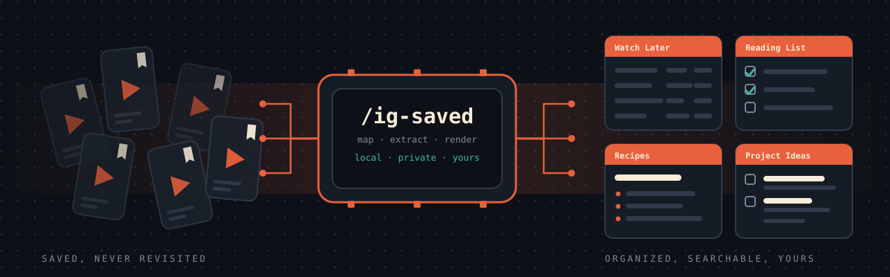
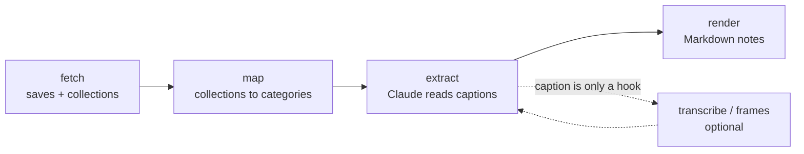

<div align="center">
  
  <h1>ig-saved-organizer</h1>
  <p><strong>A Claude Code plugin that turns your saved Instagram reels into notes you will actually open.</strong></p>
  <p>Watch-later tables · Reading list · Recipes · Project ideas · News digest · Health guide</p>
  <p>
    <a href="LICENSE"></a>
    
    
    
    
    
  </p>
  <p>
    <a href="#features">Features</a> ·
    <a href="#install">Install</a> ·
    <a href="#how-it-works">How it works</a> ·
    <a href="#what-you-get">What you get</a> ·
    <a href="#risks-and-limits">Risks and limits</a> ·
    <a href="#development">Development</a>
  </p>
</div>



You save a reel, tell yourself you'll come back to it, and never do. This plugin pulls everything you've saved, sorts it
using the collections **you already made**, has Claude read each caption and write structured notes, and, for reels
whose real content is only in the video, transcribes the audio and reads the on-screen text. The result is a folder
of plain Markdown that works as an [Obsidian](https://obsidian.md) vault.

Everything runs on your machine. Nothing is uploaded except what Claude reads in your own session.

## Features

<table>
  <tr>
    <td width="33%"><strong>Collection-aware</strong><br /><br />Claude looks at your collection names and sample captions, proposes a category for each, and you confirm. Saves in conflicting collections are sorted by Claude, not guessed.</td>
    <td width="33%"><strong>Structured extraction</strong><br /><br />Titles and authors, ingredients, links, one-line summaries. Recipe captions are copied verbatim, so quantities are never retyped or garbled.</td>
    <td width="33%"><strong>Fills the gaps</strong><br /><br />Many captions are just "comment GUIDE for the link". Optional Whisper transcripts and frame contact sheets recover what's only in the video.</td>
  </tr>
  <tr>
    <td><strong>Obsidian-ready</strong><br /><br />Wikilinks, one note per recipe with properties you can query with Bases, checklists, and a <em>Needs Review</em> list for anything Claude couldn't read.</td>
    <td><strong>Local &amp; private</strong><br /><br />All state lives in <code>~/.ig-saved</code>. Your cookie is never pasted into chat. Delete one folder and it's all gone.</td>
    <td><strong>Built for long runs</strong><br /><br />Transcription resumes from a cache, restarts after a crash, and kills a reel that hangs, so an overnight run can't stall.</td>
  </tr>
</table>

## Install

```bash
claude plugin marketplace add Royal-Dragon/ig-saved-organizer
claude plugin install ig-saved@ig-saved-organizer
```

Then, inside Claude Code:

```
/ig-saved
```

Claude walks you through the rest. You need Python 3.10+, and `ffmpeg` only if you want transcripts.

## How it works



| Step | What happens |
|---|---|
| **1. Setup** | Creates `~/.ig-saved/` with a Python venv. Your data never goes in the plugin folder. |
| **2. Login** | You paste your instagram.com `sessionid` cookie into `~/.ig-saved/.env` yourself, never into chat. |
| **3. Fetch** | Pulls every save and which collection it's in. |
| **4. Map** | Claude proposes a category per collection (`watch_later`, `reading`, `recipe`, `project_idea`, `news`, `health`, `wishlist`, `other`, `skip`); you confirm and pick an output folder. |
| **5. Extract** | Claude reads each caption and writes structured entries. |
| **6. Render** | Writes `IG Library/` into your folder: one note per category, one per recipe, plus *Needs Review*. |
| **7. Fill gaps** *(optional)* | Whisper transcribes reels with hook-only captions (CPU, about a minute each); Claude reads contact sheets of frames for listicles whose titles are on screen. |

## What you get

An `IG Library/` folder like this (sample data):

```
IG Library/
├── Home.md
├── Watch Later.md       tables by type: movies, anime, places to eat, tools…
├── Reading List.md      titles, authors and genres, one row per book or essay
├── Recipes.md           index by course, linking to one note per recipe
├── Recipes/
│   └── Chicken Shorba.md
├── Project Ideas.md     build ideas as checkboxes, tools, learning resources
├── News.md  ·  Health Guide.md  ·  Wishlist.md
├── Needs Review.md      reels where the content is only in the video
└── Failed Reels.md      reels that couldn't be transcribed, with the reason
```

| Title | Notes | Link |
|---|---|---|
| Heat (1995) | Michael Mann crime drama | reel |
| Nobody Knows (2004) | Japanese, Kore-eda | reel |

## Risks and limits

> [!WARNING]
> **This uses Instagram's unofficial private API** ([instagrapi](https://github.com/subzeroid/instagrapi)) with your own
> login. That is against Instagram's terms and can trigger rate limits, a login challenge, or an account restriction.
> Use a secondary account if you can, run it once at a gentle pace, and don't put it in a loop.

- **Your `sessionid` is a full login credential.** Keep `~/.ig-saved/.env` private (setup applies `chmod 600`). Cookies
  expire; if fetching fails with `login_required`, log in again and re-copy it.
- **Captions are often just hooks.** Expect a real share of reels to land in *Needs Review* until you run the
  transcription step. Small Whisper models are weak in some languages, so unreliable transcripts stay flagged instead
  of being guessed at.
- **Claude's extraction is a draft.** It's instructed to use only what's in the caption, transcript or frames, but check
  anything that matters (quantities, medical advice).
- Instagram's collection counts run slightly higher than what the API returns (deleted or private posts).
- Transcription downloads each video through your login. Keep the machine awake; if it sleeps, rerun and it resumes.
- **Developed and tested on Linux.** The transcription supervisor uses GNU `stat`, so macOS and Windows are untested.

## Where things live

| Path | What |
|---|---|
| `~/.ig-saved/` (or `$IG_SAVED_HOME`) | cookie, `raw.json`, `config.json`, transcripts, extracted JSON, venv |
| `<your output folder>/IG Library/` | the generated notes. Regenerated each run, so don't hand-edit inside it |

To remove all your data: `rm -rf ~/.ig-saved`.

## Architecture

`fetch.py` → `list_collections.py` → *(you confirm a mapping)* → `dump.py` → *(Claude writes `extracted/*.json`)* →
`check.py` → `render.py`, with `run_transcribe.sh` and `frames.py` for reels whose content is only in the video.

- **Supervisor outside the process.** `run_transcribe.sh` restarts the transcriber after a crash and `kill -9`s a reel
  that hangs for four minutes. An in-process timeout can't interrupt a thread stuck in C code. The bad reel is recorded
  in `transcripts_failed.json` and skipped next time.
- **Incremental.** `dump.py` only lists items not yet extracted, plus `needs_content` ones that now have a transcript or
  frames.
- Extraction schemas: [`skills/ig-saved/references/schemas.md`](skills/ig-saved/references/schemas.md).

## Development

```bash
python -m unittest discover -s tests     # offline pipeline tests on synthetic data
claude plugin validate .                 # manifest check
```

The tests cover config mapping, scoping, incremental re-extraction, validation and rendering. Fetching and
transcription talk to Instagram and aren't covered by them.

## License

MIT. See [LICENSE](LICENSE). Not affiliated with Instagram, Meta, or Anthropic.
